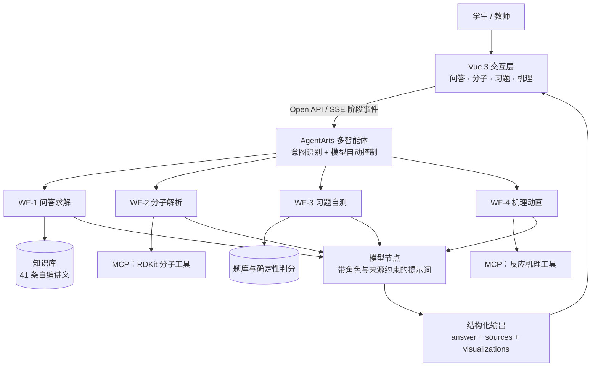

# 学智有机 · 基于华为云 AgentArts 的智能体整体设计方案（初赛）

| 项目 | 内容 |
| --- | --- |
| 赛题 | 【赛题2】基于华为云AgentArts智能体开发平台的Agent设计和应用 |
| 文档用途 | 初赛提交材料中的「设计文件」，同时作为 PPT 与演示视频的脚本依据 |
| 版本 | v1.0，2026-11-23 |
| 原型仓库 | `Xuezhi-OrganicAgent`（本地可运行前后端源码） |

> **口径声明（务必先读）**
>
> 本文把内容分成两类，不混写：
> 1. **「已实现」**：本地原型源码中真实存在的能力，附端点或文件路径；测试数字为项目文档记录的**历史基线**，本轮未全部复跑，对外报数前须在目标环境复测。
> 2. **「平台侧设计」**：按华为云 AgentArts 官方文档能力做的迁移设计，**尚未在平台部署**，不得在材料中说成已上线。
>
> 团队姓名、学号、指导教师等字段一律留占位，由团队填写；不写猜测值。

## 0. 赛题提交材料对照速查

| 赛题要求 | 本文位置 | 交付形态与状态 |
| --- | --- | --- |
| 作品简介与创意点 | 第 1 节 | 设计文件已具备；PPT 取 1.2、1.3 |
| 团队介绍 | 第 2 节 | 占位模板，待团队填写 |
| 场景定义 | 第 3 节 | 设计文件已具备 |
| 编排思路 | 第 4.1、4.2 节 | 设计文件已具备；含架构图 |
| 工作流架构 | 第 4.3 节 | 四条工作流逐节点设计 |
| 模型与资产选择 | 第 4.4 节 | 平台侧选型 + 本地原型对照 |
| 面向的行业问题 / 落地场景 | 第 5 节 | 设计文件已具备 |
| 作品 Demo 视频展示（基于 AgentArts 构建与运行的完整流程） | 第 7 节 | 分镜脚本已具备，视频待录制 |
| 作品信息收集表（Word） | 第 8.1 节 | 字段清单，待填 Word |
| 作品介绍 PPT | 第 8.2 节 | 页纲，待制作 |
| Demo 链接 | 赛题特别说明：**初赛不要求提供** | 不提交 |

## 1. 作品简介与创意点

### 1.1 一句话定位

学智有机是一个面向高中有机化学的**可验证教学智能体**：让学生问出的每一个化学结论，都能追溯到讲义依据和分子结构证据，并直接看到三维结构与反应过程。

### 1.2 作品简介（可直接用于 PPT 与信息表）

高中有机化学的难点不在记住结论，而在理解「为什么」：为什么乙醇消去生成乙烯、为什么酚羟基与醇羟基性质不同、为什么同一分子式对应不同结构。传统搜题工具给结论，通用大模型可能一本正经地编错结构，静态教辅无法呈现断键成键过程。

学智有机把「检索—解析—可视化—讲解」做成一条可核验的 Agent 链路：模型不直接拍脑袋回答，而是按规则调用受限工具集——从自编讲义检索依据、用 RDKit 解析 SMILES 与计算属性、调用反应机理数据生成断键/成键帧序列；答案同时携带知识来源与可交互的三维结构，学生可以旋转、切换视图、播放动画，再用语音讲解听一遍。系统对不可能完成的任务如实降级，不以看似完整的假答案蒙混过关。

原型已在本地跑通前后端全链路；本方案进一步按华为云 AgentArts 的多智能体、工作流、MCP、知识库与 Open API 能力给出平台化迁移设计，使教学智能体具备可管控、可观测、可复制的落地形态。

### 1.3 三个创意点（对应创新性 60% 的三条得分线）

**创意点一：把「答案可信」从口号做成硬约束。**
模型的化学映射会犯错——实测中本地 7B 模型 5 次把「乙醇」映射成 `COC`（二甲醚）而非 `CCO`。本作品不靠提示词祈祷正确，而是设三道闸：① 工具白名单，Agent 只能调用注册过的 4 个工具；② 结构化参数校验，拒绝未声明字段、不执行 `eval`；③ 分子事实一律由 RDKit 计算兜底，解析失败如实返回，不编造。回答附带真实工具返回映射出的 `sources`，检索失败标注 `partial`，审核状态固定 `unknown`，绝不写成「已审核」。

**创意点二：从「文字答案」跨到「看得见的机理」。**
把反应机理表达为带时间戳的帧序列，用键的 `opacity` 语义区分成键、断键与稳定态，前端以 Three.js 播放断键/成键动画；配合球棍/填充/线框三视图与语音讲解，形成「提问 → 证据 → 结构 → 过程 → 讲解」的多模态闭环，而不是又一个聊天框。

**创意点三：教学可控的 Agent 编排，而非单体万能提示词。**
意图识别与四条业务工作流分离：问答求解、分子解析、习题自测、机理动画各自成流；工具调用设 6 轮上限与独立超时；工具不可用时按降级矩阵只挂可用工具并在健康接口如实上报。平台侧设计进一步利用 AgentArts「单智能体自选动作 / 工作流规定动作」两种 MCP 使用方式，把需要模型灵活判断的检索交给单智能体，把必须精确可控的分子计算固定到工作流节点，兼顾灵活性与确定性。

### 1.4 与行业现有方案的差异化

| 方案 | 能回答结论 | 给依据来源 | 分子结构可交互 | 反应过程可视化 | 事实由工具校验 |
| --- | --- | --- | --- | --- | --- |
| 通用大模型聊天 | 是 | 不稳定 | 否 | 否 | 否 |
| 搜题 / 题库 App | 是 | 多为教辅答案 | 少量静态图 | 否 | 不适用 |
| 化学绘图 / 分子查看器 | 不适用 | 否 | 是 | 部分 | 是（计算工具本身） |
| **学智有机** | **是** | **是，工具返回映射** | **是，可旋转三视图** | **是，断键成键帧播放** | **是，RDKit 兜底 + 白名单** |

差异化本质：现有方案各占一环，本作品把「可信检索 + 确定性化学计算 + 过程可视化 + 语音讲解」收敛到同一 Agent 会话内，且每个环节都有明确的失败语义。

## 2. 团队介绍（占位模板，待填写）

| 字段 | 内容 |
| --- | --- |
| 团队名称 | 【待填】 |
| 参赛赛道 | 华为创新赛 · 教育赛道 / 赛题2 |
| 成员 1 | 【待填：姓名、学号、分工（如 Agent 编排与后端）】 |
| 成员 2 | 【待填：姓名、学号、分工（如前端可视化与交互）】 |
| 成员 3 | 【待填：姓名、学号、分工（如知识语料与教学设计）】 |
| 指导教师 | 【待填，如无则写「无」】 |
| 联系人 / 邮箱 | 【待填】 |

> 建议 PPT 中每人配一句「负责什么、解决什么问题」，不要只列姓名。

## 3. 场景定义

### 3.1 目标用户与真实痛点

| 用户 | 痛点 | 本作品对应能力 |
| --- | --- | --- |
| 高中生（复习/预习） | 看得懂答案，想不通过程；分子式在脑中是平面符号 | 带来源的讲解 + 3D 结构 + 机理动画 |
| 一线化学教师 | 重复答疑量大；想给学生展示微观过程但缺少工具 | 问答与习题模块可复用；动画可作为课堂演示素材 |
| 教辅 / 课程制作方 | 答案与结构素材生产流程长，质量难统一 | 知识库可替换；结构化输出便于批量生成 |

### 3.2 典型问题示例（演示与测试都可复用）

1. 「为什么乙醇能发生消去反应生成乙烯？」——检索讲义依据 + 机理动画。
2. 「`CCO` 和 `COC` 有什么不同？」——两个分子并排解析 + 官能团对比。
3. 「苯酚和乙醇的羟基性质为什么不同？」——知识检索 + SMARTS 区分醇羟基/酚羟基。
4. 「做一道有机推断练习题」——习题出题、确定性判分、错题讲解。

### 3.3 非目标与能力边界（评审时如实说明，反而加分）

- 输入只支持**文本与 SMILES**，不支持图片、手写公式或试卷识别。
- 知识库为项目自编讲义（41 条、21 个主题），**不是教材原文，尚未经化学教师审核**。
- SMILES 可解析不等于反应机理已被化学验证；动画是教学示意，不作实验结论。
- 语音使用 Edge-TTS（依赖外网），Fay 数字人默认不启动，当前无音素级口型同步。
- 本地模式的 SSE 是**阶段事件**而非逐 token 流式；不把它包装成逐字生成。
- 本地模型服务仅绑 `127.0.0.1`、无鉴权，不暴露公网；面向协作者需平台侧发布与鉴权。

## 4. Agent 设计方案

### 4.1 总体架构与编排思路

架构分三层：**交互层（Vue 3 Web）— 智能体层（AgentArts 多智能体 + 四条工作流）— 能力层（模型、知识库、MCP 工具、语音）**。前端只认结构化输出：`answer`、`sources`、`visualizations`；后端/平台侧负责把工具原始返回映射成这三个字段。

**为什么这样编排（引用平台官方能力，不做无依据发挥）：**

- AgentArts 官方将应用分为**单智能体、工作流、多智能体**三类；多智能体「支持根据用户意图在不同的工作流之间跳转」「支持模型自动控制模式」，并可做**三层嵌套（多智能体 → 多智能体 → 工作流）**。本作品用一个多智能体做总控路由，下挂四条工作流，正对应这一范式。
- 官方对两种 MCP 使用方式有明确区分：单智能体模式下工具是模型的「**自选动作**」（模型自主判断调用与参数），工作流模式下是「**规定动作**」（节点中固定调用、参数引用上游变量）。本作品据此分工：讲义检索放进需要灵活判断的问答流，RDKit 计算放进必须确定执行的分子流。
- 官方建议单个智能体关联的 MCP 总数**不超过 5 个**，并要求在提示词中写明每个工具的使用时机、调用条件和参数确认规则。本作品恰好 4 个工具，并为每个工具写清触发条件与「信息不全先追问、不猜测填写」规则。
- 工作流支持**串行与并行**编排，并在变量聚合中整合结果；本作品在问答流中并行跑「知识检索」与「分子解析」，再聚合到回答节点。

### 4.2 已实现原型与平台侧设计的对应关系

| 能力 | 本地原型（已实现） | AgentArts 平台侧（设计，待部署） |
| --- | --- | --- |
| 意图路由 | Agent 循环按工具白名单调度，最多 6 轮 | 多智能体应用做意图识别与工作流跳转 |
| 工具调用 | 4 个注册工具 + 参数校验 + 独立超时 | 同签名封装为 MCP 服务；单智能体自选 / 工作流规定动作 |
| 知识检索 | ChromaDB + `bge-small-zh`，自编讲义 41 条 | 平台知识库 + 知识检索节点（`output_list`） |
| 结构化输出 | `sources` / `visualizations` 由工具真实返回映射 | 工作流输出变量聚合，前端按同一契约渲染 |
| 调试可观测 | 分模块验证文档 + `/health`、`/ready` | 平台全链路调试（意图识别、知识检索逐步可见） |
| 对外集成 | FastAPI `12` 端点 / OpenAPI `22` schema | 发布为 Open API，前端携带 `agent_id` / `conversation_id` 调用 |

### 4.3 四条工作流的逐节点设计

**WF-1 问答求解流（串行 + 并行）**

| 节点 | 类型 | 输入 → 输出 | 关键约束 |
| --- | --- | --- | --- |
| N1 | 输入 | 学生问题文本 | 空问题直接拒绝 |
| N2 | LLM 意图/参数 | 问题 → `{need_knowledge, need_molecule, query}` | 信息不全先追问；不猜测分子 |
| N3a | 知识检索 | `query` → `output_list[document_name, subtitle, content, score]` | 平台官方 query 参数名固定；按 score 降序 |
| N3b | MCP 分子解析 | 抽取到的 SMILES → 属性 JSON | 失败走异常分支，不中断全流程 |
| N4 | 变量聚合 | N3a + N3b → 证据集合 | 并行结果统一整合 |
| N5 | LLM 生成 | 证据 + 角色提示词 → `answer` | 只允许引用证据内容；无证据时说明不确定 |
| N6 | 输出映射 | → `answer` + `sources` + `visualizations` | 检索失败标 `partial`，审核状态 `unknown` |

**WF-2 分子解析流（确定性优先）**

| 节点 | 类型 | 输入 → 输出 | 关键约束 |
| --- | --- | --- | --- |
| N1 | 输入 | SMILES 字符串 | 语法校验先行 |
| N2 | MCP（规定动作） | SMILES → `parse_smiles` / `describe_molecule` 结果 | 节点固定调用，参数引用上游变量 |
| N3 | 条件分支 | 解析成功 → 渲染；失败 → 错误文案 | 不把无效 SMILES 交给模型自由发挥 |
| N4 | 输出 | 分子属性 + 3D 结构数据 | 前端 Three.js 三视图渲染 |

**WF-3 习题自测流**

| 节点 | 类型 | 输入 → 输出 | 关键约束 |
| --- | --- | --- | --- |
| N1 | 输入 | 题量与主题 | 超出题库范围时明确告知 |
| N2 | 题库读取 | → 题目与标准答案 | 判分用确定性逻辑，不交给模型 |
| N3 | 判分 | 学生作答 → 正确/错误 + 解析 | 已实现原型为确定性判分 |
| N4 | LLM 错题讲解 | 错误点 + 讲义切片 → 讲解文本 | 讲解须引用讲义依据 |

**WF-4 机理动画流**

| 节点 | 类型 | 输入 → 输出 | 关键约束 |
| --- | --- | --- | --- |
| N1 | 输入 | 反应名称 / ID | 清单由后端接口拉取，失败才用内置回退 |
| N2 | MCP（规定动作） | → `find_reaction_mechanism` 帧序列 | 帧含 `opacity`，>0.02 才算可见 |
| N3 | 校验 | 帧单调性与键状态一致性 | 不合法帧不进入播放 |
| N4 | 输出 | 帧序列 + 讲解文本 | 前端按时间戳播放断键/成键 |

**异常分支的通用规则**（官方明确建议）：MCP 可能因超时、参数错误、服务异常失败，工作流须配置异常处理分支，避免单个节点报错中断整个流程；本作品在每条流的 MCP 节点后都接「失败 → 如实说明 + 降级输出」分支。

### 4.4 模型与资产选择

**模型**

| 场景 | 选择 | 依据 |
| --- | --- | --- |
| 平台侧（参赛方案） | AgentArts 平台可选模型，按学生问答与中文表达效果在调试面板实测后确定 | 不在未实测前写死具体型号 |
| 本地原型（已跑通） | `qwen2.5-7b-local`，llama.cpp server，OpenAI 兼容端点 `http://127.0.0.1:8080/v1` | 复用已有本地权重，无需云端密钥；工具调用协议实测 5/5 标准 `tool_calls` |
| Embedding | `BAAI/bge-small-zh`（512 维、已归一化） | 中文检索质量优于默认英文嵌入；原型已验证 |

本地模型的两个必须写进材料的限制：① 运行时须加 `--chat_format chatml-function-calling`，否则工具调用原文落在正文、Agent 链路断；② 客户端显式 `tool_choice="auto"`，否则本地 llama.cpp 不启用工具解析；且本地端点**流式与工具不可兼得**，默认关流式走同步降级。化学事实不信任模型映射，一律工具兜底。

**资产**

| 资产 | 内容 | 平台映射 |
| --- | --- | --- |
| 知识库 | 自编高中有机化学讲义 41 条、21 主题 | AgentArts 知识库 + 知识检索节点 |
| 工具资产 | `parse_smiles`、`describe_molecule`、`search_knowledge`、`find_reaction_mechanism` | 4 个 MCP 服务；数量满足官方 ≤5 建议 |
| 提示词资产 | 角色设定、工具使用规则、来源约束、追问规则 | 平台提示词资源 + 智能体系统提示词 |
| 题库 | 习题与标准答案、确定性判分 | 平台插件 / MCP + 工作流节点 |
| 对话体验 | 开场白、推荐问题、追问、音色、显示引用和归属、内容审核 | 平台官方提供的对话体验配置项 |
| 记忆 | 学习偏好与上下文变量 | 平台「为应用添加记忆 / 聊天记忆技能」 |

**接口契约**：平台发布为 Open API 后，前端按现有契约消费 `answer` / `sources` / `visualizations` 与阶段事件；本地原型的契约已由 OpenAPI 文件与测试固定（12 端点 / 22 schema），迁移时以契约为验收门禁，而非改前端硬编码。

### 4.5 安全与降级

- 工具白名单 + 参数白名单：**不执行模型给出的任意表达式**；未声明参数直接拒绝。
- 工具失败、RDKit 不可用、检索无命中：分别走降级分支，健康接口如实上报，不用「假成功」填充答案。
- 本地模型服务无鉴权且仅绑回环地址；面向评审/协作者演示时使用平台发布链接或加网关鉴权，不把本地端口映射到公网。
- 知识来源标注真实工具返回；`review_status` 保持 `unknown`，未经教师审核不得声称已审核。

## 5. 面向的行业问题与落地场景

### 5.1 精准定位的真实需求

问题不是「学生不会查答案」，而是「答案缺少证据链与微观过程」。高中有机化学的抽象性使结构、官能团与反应机理高度依赖空间想象；教师课堂时间有限，无法为每人重复演示。学智有机把这两件事自动化：**证据可追溯**解决可信问题，**三维过程可视化**解决理解问题。

### 5.2 落地路径（三步，不跳步）

1. **校内试点**：作为课堂演示与课后答疑辅助，知识库由备课组审核后上线；教师先用机理动画做讲解素材。
2. **教辅 / 培训机构**：替换知识库为机构自有讲义与题库，复用四条工作流与可视化组件，形成机构品牌化的答疑应用。
3. **平台化复制**：在 AgentArts 上以模板形式发布，新学科只需换「知识库 + 专业 MCP 工具」，编排层与前端复用。

### 5.3 商用潜力与规模化依据

- **可复制**：知识库、题库、工具三者与编排解耦；换学科不重写 Agent。
- **可规模化**：平台侧由 AgentArts 承担运行、发布、监控与运维；本地原型已证明工具调用与可视化链路可在无云密钥环境下跑通，降低试点门槛。
- **成本可控**：本地 7B 模型可承担演示与开发验证；平台侧按实际并发选模型规格，避免为教学内容盲上大模型。
- **风险已知**：知识内容需教师审核、化学计算依赖 RDKit、模型化学映射不可信——这些都在方案里给了兜底，而不是回避。

## 6. 评审标准逐条对照

### 6.1 创新性（60%）

| 评审点 | 本作品举证 | 证据位置 |
| --- | --- | --- |
| AI 应用场景创新（新场景或传统场景新突破） | 把「可信证据链 + 分子三维过程」引入高中化学答疑，从答案交付转向理解过程交付 | 第 1.2、3.1 节 |
| 与行业现有方案形成差异化 | 搜题、通用大模型、分子查看器各占一环；本作品四合一且事实由工具校验 | 第 1.4 节对比表 |
| 智能体设计思路 / 交互方式创新 | 多智能体路由 + 双模式 MCP（自选/规定动作）+ 6 轮上限 + 降级矩阵；问答自动跳转到机理动画页 | 第 4.1、4.3 节 |

### 6.2 应用价值（40%）

| 评审点 | 本作品举证 | 证据位置 |
| --- | --- | --- |
| 精准定位真实需求并解决 | 学生「懂结论不懂过程」、教师「重复答疑与演示难」两类痛点，逐项对应能力 | 第 3.1 节 |
| 商用落地潜力、可复制性与规模化 | 三步落地路径；知识库/题库/工具与编排解耦；平台托管运行 | 第 5.2、5.3 节 |
| Agent 架构设计合理、具有可行性 | 本地原型已跑通前后端与工具链路；平台侧设计逐节点对应官方能力；有契约与降级 | 第 4.2、4.3、4.5 节 |

## 7. Demo 视频脚本（基于 AgentArts 构建与运行的完整流程）

> 建议时长 4–5 分钟，全程录屏 + 画外音；展示重点是**在 AgentArts 上构建并运行**，不是只放本地前端效果。初赛不要求提交 Demo 链接，视频文件随材料提交即可。

| 镜号 | 时长 | 画面（录屏） | 口播要点 |
| --- | --- | --- | --- |
| 1 | 0:00–0:20 | 片头：标题 + 作品定位 + 赛题 | 「我们做的是让答案有依据、分子看得见的教学智能体」 |
| 2 | 0:20–0:50 | AgentArts 控制台：创建空间与应用，展示三类应用入口 | 「按平台能力，我们采用多智能体做总控、工作流承载业务」 |
| 3 | 0:50–1:25 | 知识库：上传自编讲义切片，查看检索参数 | 「讲义切片入知识库，检索结果带文档名、子标题与得分」 |
| 4 | 1:25–2:00 | MCP 组件：展示 4 个工具的 description 与参数，挂到智能体 | 「四个工具就是模型的手；提示词写明使用时机与参数确认规则」 |
| 5 | 2:00–2:40 | 工作流画布：逐帧展示 WF-1 的检索、并行解析、变量聚合与异常分支 | 「确定性的计算走规定动作，自由问答走自选动作」 |
| 6 | 2:40–3:10 | 多智能体编排：意图跳转到四条工作流，发布为 API | 「一次提问，平台按意图路由到不同工作流，发布后前端按契约调用」 |
| 7 | 3:10–3:50 | 运行演示：提问「乙醇消去反应机理」，展示来源、3D 分子与动画 | 「答案不是一句结论：有讲义依据、有结构、有断键成键过程」 |
| 8 | 3:50–4:20 | 运行演示：习题判分与错题讲解；展示失败降级一例 | 「判分是确定性的；工具失败时如实说明，不编答案」 |
| 9 | 4:20–4:40 | 平台全链路调试视图 + 结尾页：创新点与应用价值各三条 | 「可观测、可复制、可落地——这就是学智有机」 |

录制前检查：① 平台账号与空间就绪、应用已发布；② 知识库启用、MCP 调试通过；③ 演示问题在平台侧预先试跑一遍；④ 视频中不出现密钥、内部路径或个人信息。

## 8. 提交材料制作清单

### 8.1 作品信息收集表（Word）字段占位

| 字段 | 填写来源 |
| --- | --- |
| 作品名称 | 「学智有机——面向高中有机化学的可验证教学智能体」 |
| 赛题 | 赛题2：基于华为云 AgentArts 智能体开发平台的 Agent 设计和应用 |
| 团队成员与分工 | 第 2 节，待填 |
| 作品简介 | 第 1.2 节 |
| 创意点 / 创新性说明 | 第 1.3、6.1 节 |
| 应用场景与行业问题 | 第 3、5.1 节 |
| Agent 设计方案 | 第 4 节（可摘架构图与四条工作流表） |
| 应用价值说明 | 第 5.2、5.3、6.2 节 |
| 演示视频说明 | 第 7 节分镜 |
| Demo 链接 | 初赛不要求，留空或写「不适用」 |

### 8.2 作品介绍 PPT 页纲（建议 10 页）

1. 封面：作品名 + 一句话定位。
2. 痛点：结论有了，依据与过程没有。
3. 作品简介：四步闭环（检索 → 解析 → 可视化 → 讲解）。
4. 创意点一：可验证问答（三道闸 + 乙醇/二甲醚实例）。
5. 创意点二：看得见的机理（三视图 + 帧动画）。
6. 创意点三：教学可控的编排（多智能体 + 双模式 MCP）。
7. 架构图：第 4.1 节图。
8. 工作流与资产：四条流 + 4 工具 + 知识库 + 模型选择。
9. 落地场景与评审对照：第 5、6 节各三条。
10. 演示流程与团队介绍：视频二维码/文件名 + 成员分工。

## 9. 真实性边界与待办

| 事项 | 当前状态 | 待办 |
| --- | --- | --- |
| 本地原型前后端与四工具链路 | 已实现，可本地运行 | 对外报测试数前复跑 |
| AgentArts 平台侧应用 / 工作流 / MCP / 知识库 | **未部署，仅为设计** | 需在平台按第 7 节镜号 2–6 实际搭建并录屏 |
| 团队信息 | 占位 | 团队填写 |
| 知识库内容审核 | 未完成 | 化学教师审核后才能在落地场景宣称可信 |
| 平台模型选型 | 未实测 | 在调试面板对比后确定，不写未验证的型号 |
| 演示视频 | 脚本完成，未录制 | 按第 7 节录制 |

> 未决事项按项目规范登记到 [决策登记表](decision-register.md)；本文不写猜测值。

## 附录 A：本文事实依据（本地原型）

| 事实 | 位置 |
| --- | --- |
| 功能与已知限制、历史测试基线 | [项目 README](../README.md)、[产品范围与验收标准](product-scope.md) |
| 工具白名单与调度上限 | `backend/app/agent/tools.py`、`backend/app/agent/dispatcher.py`；[Agent 编排层实现与验证状态](agent-dispatcher-verification.md) |
| 真实端点清单 | `backend/app/api/routes.py`、`backend/app/quiz/routes.py`、`backend/app/reaction/routes.py` |
| 知识语料 41 条 / 21 主题 | [有机化学自编讲义验证](organic-corpus-verification.md) |
| 本地 qwen 工具调用实测与限制 | [本地 qwen 推理运行时](local-qwen-runtime.md) |
| 机理帧 `opacity` 语义 | [反应机理 3D 可视化模块](reaction-mechanism-viz-module.md) |
| 前端四标签与可视化 | [前端实现与实测](frontend-verification.md)、[3D 分子可视化](frontend-viz-verification.md) |

## 附录 B：AgentArts 官方能力依据（联网查证，2026-11-23）

| 能力 | 官方页面 |
| --- | --- |
| 三类应用开发流程、技能/知识库/记忆/MCP/体验/发布/API | https://support.huaweicloud.com/usermanual-agentarts0/agentarts_05_0001.html |
| 多智能体介绍（意图跳转、自动控制、三层嵌套） | https://support.huaweicloud.com/usermanual-agentarts0/agentarts_05_0103.html |
| 创建多智能体应用 | https://support.huaweicloud.com/usermanual-agentarts0/agentarts_05_0106.html |
| 工作流编排逻辑（串行/并行/变量聚合/资源） | https://support.huaweicloud.com/usermanual-agentarts0/agentarts_05_0046.html |
| 单智能体使用 MCP（自选动作、提示词规则、≤5 个） | https://support.huaweicloud.com/usermanual-agentarts0/agentarts_05_0138.html |
| 工作流使用 MCP（规定动作、参数、异常分支） | https://support.huaweicloud.com/usermanual-agentarts0/agentarts_05_0139.html |
| 工作流使用知识库（`output_list` 字段） | https://support.huaweicloud.com/usermanual-agentarts0/agentarts_05_0174.html |
| 通过 API 调用单智能体（`agent_id` / `conversation_id`） | https://support.huaweicloud.com/usermanual-agentarts0/agentarts_05_0038.html |
